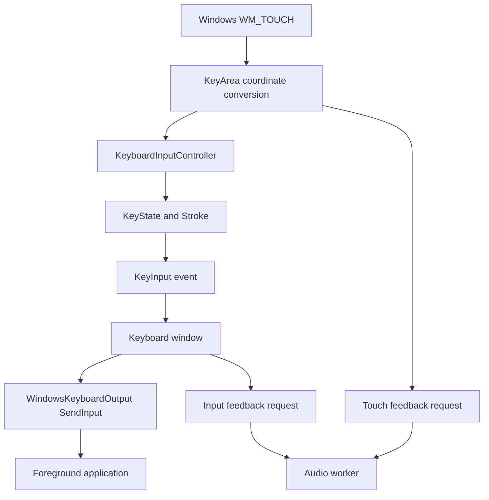
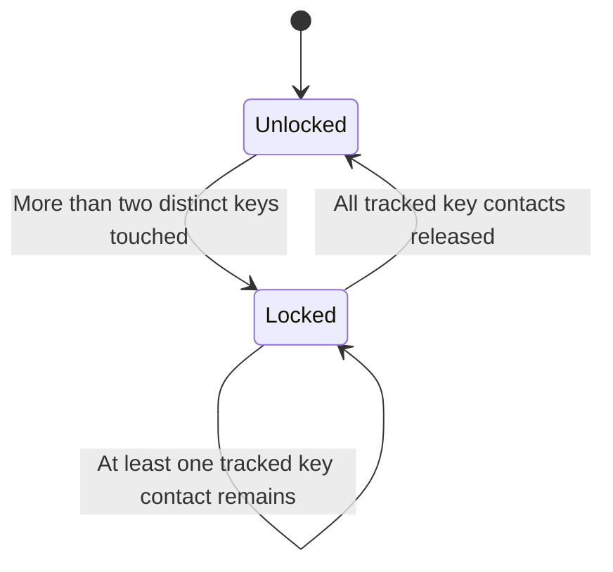

# Tapboard+

## Software Architecture and Input Logic

**Implementation snapshot:** October 10, 2026  
**Basis:** The current source code and the original TapBoard paper supplied by the project owner.

## 1 Design Goals

Tapboard+ is a Windows touchscreen keyboard for the lower display of an ASUS dual-screen laptop. The upper display remains available for applications. Its central goal is to let users rest their fingers on a touchscreen without treating every contact as a keystroke.

A **contact** is one continuous touch from finger-down to finger-up. A **tap** is a contact that is sufficiently short and has sufficiently small displacement. **Resting** means keeping a finger or hand on the surface without intending to type. Tapboard+ distinguishes these actions through software rules rather than pressure or impact sensors.

### 1.1 Allow resting between typing actions

Character keys do not produce input immediately on finger-down. They produce input on finger-up only if the completed contact satisfies the tap criteria. Long contacts therefore do not type. A separate lock policy suppresses input when more than two distinct keys are touched.

The application covers the entire lower display, including the blank area below the keyboard. Contacts in that blank area do not type or consume a key-contact slot. The application also filters touch-generated mouse events to reduce unintended interaction with other windows while the user rests a hand.

### 1.2 Preserve familiar typing skills and physical dimensions

The keyboard uses a QWERTY layout with a nominal **19.5 mm key pitch**, meaning the center-to-center spacing of adjacent standard keys. It supports modifier keys, repeating Backspace and arrow keys, Korean/English input, and Caps Lock.

Different key types have different interaction requirements. Character entry uses brief taps, modifier keys remain active while held, and repeating keys respond immediately. Applying the same release-based rule to every key would interfere with these familiar operations.

### 1.3 Avoid unnecessary processing and feedback delays

Waiting for finger-up is an intentional part of tap classification. The implementation aims to avoid adding unnecessary delay through full-screen painting, audio-device startup, or disk writes in the touch handler.

Touch-down feedback and input feedback are separate sounds, and either can be disabled. Input processing does not wait for a sound to finish.

### 1.4 Operate without additional sensors

The current keyboard does not use Arduino events, bezel touch sensors, impact-sound measurements, or haptic actuators. All input decisions use touchscreen contact events. Earlier sensor integration has been removed from the keyboard application.

### 1.5 Add passive tactile landmarks

A planned **0.1 mm plastic-film overlay** contains openings aligned with the visible keys. Its edges are intended to help users locate keys by touch while retaining the ability to rest on the surface. Whether this thickness and opening geometry provide useful tactile guidance remains a question for fabrication trials and user evaluation.

## 2 Relationship to the Original TapBoard Research

The research foundation is *TapBoard: Making a Touch Screen Keyboard More Touchable*, published at CHI 2013 by Sunjun Kim, Jeongmin Son, Geehyuk Lee, Hwan Kim, and Woohun Lee. [1]

The paper distinguishes three physical-key states: **released**, **touched**, and **pressed**. Conventional touchscreen keyboards commonly treat contact as a press, leaving no separate state for touching a key without activating it. TapBoard instead maps a brief tapping event to a keystroke, making sustained contact available for resting and finger alignment. [1, pp. 553–555]

### 2.1 Principles retained and implementation changes

| Aspect | Original TapBoard paper | Current Tapboard+ |
| --- | --- | --- |
| Basic input rule | Accept brief contacts with small displacement | Accept a tap on release when duration and final displacement pass the thresholds |
| Duration threshold | Initially 300 ms; later experiments used 450 ms | Currently 300 ms, configurable |
| Displacement threshold | Initially 80 px; an additional experiment examined 50 px | Currently 60 px, configurable |
| Simultaneous contacts | The prototype handled at most five contacts to address device behavior | More than two distinct touched keys causes a global input lock |
| Special-key exceptions | Shift and Backspace excluded from the tap rule | Explicit `TAPPER`, `NORMAL`, and `MODIFIER` types |
| Application setting | Research prototypes on a tablet and tabletop | A lower-display keyboard that sends input to another application |
| Tactile overlay | OHP film with 0.2 mm urethane-film stickers | A proposed 0.1 mm film with laser-cut openings |

Pixel thresholds from different devices are not directly comparable physical distances. The current 60 px displacement threshold changes in physical size with screen pixel density.

### 2.2 What the original experiments establish

The observational study reported resting behavior in four of five participants. A separate comparison involving ten participants found no significant condition effect on typing speed or error measures between TapBoard and a conventional touchscreen keyboard. The authors also reported equivalence tests using consecutive sessions. These findings concern the devices, tasks, participants, and parameters of those studies. [1, pp. 557–559]

They motivate Tapboard+ but do **not** establish the typing performance, fatigue reduction, or error rate of this new implementation on an ASUS laptop.

### 2.3 Important differences from the original concept

The current two-key limit is deliberately restrictive. Users can rest several fingers on keys, but doing so locks input until all tracked key contacts are released. Typing with one finger while several other fingers remain on different keys—called **anchored typing** in the paper—is therefore restricted by the current policy. [1, p. 560]

The paper describes a state machine that cancels input when the duration or displacement threshold is exceeded. The current implementation instead stores the starting and latest positions and evaluates the contact on release. It does not permanently cancel a contact when its maximum displacement exceeds the threshold. A finger can move away, return near its starting point, and still produce input if it is released within the duration limit. This distinction matters when reasoning about gestures and accidental contacts.

## 3 Software Architecture

Tapboard+ is implemented in **C# Windows Forms**, targeting **.NET Framework 4.8**. It receives native Windows touch events. The old `Windows7.Multitouch` libraries are not used by the current project.

The implementation separates window integration, input policy, key state, rendering, keyboard output, and background services.

| Component | Main files | Responsibility |
| --- | --- | --- |
| Application and window | `Program.cs`, `Keyboard.cs` | Startup, DPI awareness, display selection, window lifetime, service connections |
| Touch and UI adapter | `KeyArea.cs`, `WindowsTouchInput.cs` | Receive `WM_TOUCH`, convert coordinates, dispatch contacts, run UI timers, request repainting |
| Input policy | `KeyboardInputController.cs` | Contact ownership, distinct-key limit, lock/unlock behavior, modifier state, repeat dispatch |
| Key model | `Key.cs`, `KeyDefinition.cs`, `KeyState.cs`, `Stroke.cs` | Key identity and geometry, active contacts, tap classification |
| Layout and appearance | `KeyboardLayout.cs`, `KeyRenderer.cs`, `KeyboardTheme.cs` | Physical-unit layout, hit regions, labels, colors, drawing |
| Windows input output | `WindowsKeyboardOutput.cs` | Convert key requests into native key transitions using `SendInput` |
| Touch isolation | `TouchMouseFilter.cs`, `TouchGestureSettings.cs` | Filter touch-generated mouse events and configure per-window gestures |
| Environment services | `DisplayGeometry.cs`, `ImeStateReader.cs` | Physical display calibration and foreground language-state queries |
| Configuration | `KeyboardSettings.cs` | Read and validate immutable startup settings |
| Audio | `ClickFeedback.cs`, `ClickMixer.cs` | Persistent WASAPI stream and waveform synthesis |
| Diagnostics | `TouchDiagnostics.cs` | Bounded event history and periodic CSV snapshots |

### 3.1 Main input path



The diagram shows the event and service relationships. Touch feedback is requested only when the controller permits a key-down contact; input feedback follows the output path. Neither audio path blocks input processing.

Rendering is a separate path: state changes cause `KeyArea` to invalidate affected rectangles, and `KeyRenderer` draws the requested regions. Drawing does not classify contacts or emit input.

### 3.2 State ownership

`KeyDefinition` holds the key's name, labels, type, geometry, and base appearance. `KeyState` holds active contacts and repeat state. `Key` connects a definition to its state.

`KeyboardLayout` is the source of keyboard geometry. For example, it explicitly assigns the extended Space hit region. The input controller does not need to recognize the Space key by its name to apply that geometry.

Contact dictionaries and key states are changed on the UI thread. The controller does not depend on a WinForms `Control` or native window handle, which makes its policy easier to test independently.

| Execution context | Work |
| --- | --- |
| UI thread | Contact tracking, tap decisions, lock state, repeat checks, drawing, diagnostic snapshot creation |
| Dedicated audio thread | Audio-device operation and waveform rendering |
| Dedicated mouse-hook thread | Mouse-message filtering and its message loop |
| Background worker tasks | IME queries and periodic diagnostic-file writes |

## 4 Contact Processing and Tap Classification

### 4.1 Native coordinates

`KeyArea` receives `WM_TOUCH` packets. Windows touch coordinates are expressed in hundredths of a screen pixel. The adapter converts them to pixels and uses `PointToClient` to obtain coordinates relative to the keyboard control.

The application requests per-monitor DPI awareness at startup. Its touch coordinates, key rectangles, and drawing use physical pixel coordinates so that display scaling does not create an additional mismatch.

### 4.2 Assign a contact to a key once

On finger-down, the controller searches the hit regions and records:

```text
contact ID → original key
```

Subsequent move and release events go directly to that original key through the contact dictionary. They do not scan all keys or assign the contact to a different key based on its latest position. This preserves ownership when a finger leaves the original key before release.

Contacts that start in blank space are not assigned to a key and do not become key contacts merely by moving over the keyboard.

### 4.3 Preflight all new contacts in a packet

A native packet can contain several contact updates. The adapter processes it in two passes:

1. Register every new `DOWN` contact and check the distinct-key limit.
2. Deliver the packet's `DOWN`, `MOVE`, and `UP` events.

This ordering prevents an earlier-listed `UP` from committing a tap before a third key-down in the same packet has triggered cancellation.

### 4.4 Three key types

| Type | On finger-down | While held or on release |
| --- | --- | --- |
| `TAPPER` | Start a separate `Stroke` for the contact ID | On release, emit one input only if the completed contact qualifies as a tap |
| `NORMAL` | Emit input immediately and start repeat scheduling | Repeat while held; stop on release |
| `MODIFIER` | Activate the modifier state | Stay active until the owning contact releases |

The current layout assigns types as follows:

- **TAPPER:** letters, numbers, punctuation, Space, Enter, Tab, Caps Lock, Korean/English toggle, Hanja, Esc, function keys, and Del.
- **NORMAL:** Backspace, arrow keys, and the application-exit button.
- **MODIFIER:** Shift, Ctrl, Alt, and Win.

The exit button closes the window on its initial activation, so it does not continue into repeated activation.

### 4.5 Brief-tap criteria

`Stroke` records a start time with `Stopwatch`, the starting coordinates, and the latest coordinates. Move and release events update the latest coordinates.

A tapping contact produces input only on release when both conditions hold:

```text
elapsed time < TapDurationMs
integer release displacement < TapDistancePixels
```

The release displacement is the Euclidean distance from the starting point to the release point. The current code truncates the square-root result to an integer before comparing it. It does not accumulate the traveled path.

Current thresholds are **300 ms** and **60 px**. Equality does not pass.

| Contact | Result |
| --- | --- |
| Release after 100 ms, 8 px from the start | One input |
| Rest for 700 ms, then release | No input |
| Release after 120 ms, 80 px from the start | No input |
| Move far away, return within 5 px, and release after 200 ms | Input is possible under the current final-displacement rule |
| Two overlapping contacts on the same tapping key | Each ID is tracked and classified independently |

A long contact cannot become a fresh tap without a new down event. There is no minimum-duration or minimum-force requirement, so a very brief brushing contact can still qualify. Removing the impact sensor leaves that distinction to touchscreen events and the existing software rules.

## 5 Global Lock, Modifiers, and Repeating Keys

### 5.1 Count distinct touched keys

The current `MaxActiveKeys` value is **2**. The controller counts distinct `Key` objects in its contact dictionary, rather than counting fingers.

- Two contacts on the same key count as one key.
- A modifier key counts as a key.
- A long resting contact still counts until it is released, even after it can no longer qualify as a tap.
- Blank-area contacts do not count.

### 5.2 Lock and unlock behavior

When a third distinct key receives a down contact, the controller:

1. Enters the locked state.
2. Cancels pending strokes on all keys.
3. Stops repeat schedules.
4. Releases Win if it was active.
5. Continues tracking key contacts without accepting input.

The lock ends only when **all tracked key contacts have been released**. New key contacts made while locked also delay unlocking until they are released. Input already sent before the lock cannot be retracted.



| Situation | Behavior |
| --- | --- |
| One letter key, or Shift plus a letter | Apply the normal per-key rules |
| A third distinct key is touched | Cancel pending input and lock |
| Only some fingers are lifted | Remain locked |
| Every tracked key contact is lifted | Unlock; accept fresh contacts |
| A palm touches the blank area below the keys | No typing and no extra key slot |

The locked keyboard uses a slightly darker version of its base colors. `LockedBrightness = 0.85` controls that appearance.

### 5.3 Modifier handling

Shift, Ctrl, and Alt are tracked as software-held states. When another key is emitted, `WindowsKeyboardOutput` builds the necessary sequence of modifier-down events, target-key down/up, and modifier-up events.

Physical modifier keys that are already held are preserved: the application avoids injecting a duplicate press or releasing the user's physical modifier.

For a `TAPPER` key, modifier state is sampled when input is committed on release. Releasing Shift before releasing the letter can therefore remove Shift from the resulting combination.

Win uses a separate held native down/up path. Locking, layout reset, and application shutdown release it so that it is not left logically held.

The Korean/English and Hanja keys send their corresponding virtual keys. The target application's input method editor (**IME**) performs text composition; Tapboard+ does not compose Hangul syllables itself.

### 5.4 Repeat scheduling

`NORMAL` keys emit once on down. Their first repeat is scheduled after `RepeatIntervalMs`, currently **100 ms**. A UI timer checks repeat eligibility every **10 ms**, using a monotonic `Stopwatch` clock for the deadlines.

After a repeat is emitted, the next deadline becomes:

```text
current time + repeat interval
```

A late callback does not trigger catch-up bursts or shorten the following interval. Release and global lock stop repetition. UI scheduling can still make an interval longer than requested; the policy enforces a minimum separation rather than a hard real-time period.

## 6 Windows Integration and Touch Isolation

### 6.1 Display selection and focus

`DisplayGeometry` first checks `KeyboardDisplay`. If no valid matching name is selected, it chooses the monitor whose bottom edge is lowest in the Windows desktop arrangement.

The application covers that entire display and places the keyboard at the top, centered horizontally. `WS_EX_NOACTIVATE` allows the foreground application to retain focus when the user touches the keyboard.

### 6.2 Native keyboard output and labels

`WindowsKeyboardOutput` injects virtual-key transitions with `SendInput` rather than inserting precomposed text. The target application's IME, Caps Lock, and physical modifier state therefore remain responsible for interpreting those key events.

The labels follow the foreground application's Korean/English IME state. Korean labels represent two-set keyboard key positions. Shift updates the appropriate labels; Caps Lock changes English letter case. IME queries run asynchronously, and the last known language is retained if a query cannot determine the state.

### 6.3 Immediate touch delivery

The control registers for touch using `TWF_WANTPALM`, requesting delivery that includes resting contacts without waiting for Windows palm classification.

Tapboard+ does not introduce a separate palm-rejection waiting period. It makes its decisions from key type, duration, displacement, and the number of distinct touched keys. This does not recover contacts that a touch device or driver never delivers.

### 6.4 Per-window gesture settings

`TouchGestureSettings` configures the keyboard window and control to suppress press-and-hold, flicks, and legacy Windows gesture handling. These settings are local to the application's windows.

### 6.5 Application-lifetime mouse hook

`TouchMouseFilter` installs a `WH_MOUSE_LL` low-level mouse hook on a dedicated message thread. The hook observes messages globally, but its blocking policy targets touch-generated mouse interaction associated with the keyboard window.

| Input | Policy |
| --- | --- |
| Touch-generated mouse events inside the keyboard window | Block, including the blank resting area |
| A blocked touch sequence that moves outside | Continue suppressing that sequence |
| Physical mouse or pen events | Pass through |
| A touch sequence starting outside and moving over the keyboard | Preserve its original press/release sequence |
| Long-press messages at the old cursor position associated with the primary touch | Filter using primary-touch ownership |
| Application closes | Stop the hook thread and remove the hook |

This protects physical-mouse dragging from unrelated touch-generated mouse messages. It is not a global disabling of the mouse or all Windows touch behavior.

Windows may still hide the cursor during touch. System edge gestures, such as opening the notification/calendar panel, are separate from these per-window settings. The current code should not be described as disabling every system edge gesture.

## 7 Audio Feedback and Responsiveness

### 7.1 Two feedback events

**Touch feedback** is requested when a permitted key-down contact is accepted for tracking. A contact that later becomes resting may therefore produce a touch sound. Blank-space contacts and down events blocked by the global lock do not request it.

**Input feedback** is requested through the keyboard-output path. Modifier state changes alone do not produce the input tone.

| Property | Touch sound | Input sound |
| --- | --- | --- |
| Pitch | C4, approximately 261.63 Hz | E4, approximately 329.63 Hz |
| Duration | 70 ms | 60 ms |
| Synthesis gain | 0.07 | 0.12 |
| Waveform | Pure sine with a smooth envelope | Pure sine with a smooth envelope |
| Current source setting | `TouchSoundEnabled = false` | `InputSoundEnabled = true` |

Each channel can be enabled independently. If both are disabled, the audio engine is not started. The table gives the current `app.config` values, which can differ from class defaults or a previously copied deployment configuration.

### 7.2 Persistent WASAPI stream

`ClickFeedback` opens an event-driven WASAPI shared-mode stream through `IAudioClient3` on a dedicated worker thread. The stream remains open during silence. The program does not open the audio device or load a sound file for each keystroke.

It requests the minimum supported engine period. If another shared stream has fixed the period, it retries with the current shared-mode period. It aims to keep about one engine period queued instead of filling the endpoint's entire buffer with silence.

Input handlers only increment request counters using `Interlocked`. The audio worker drains those counters and asks `ClickMixer` to synthesize the output. Input processing never waits for playback completion.

### 7.3 Waveform generation and overlapping requests

`ClickMixer` prepares waveform arrays at startup. A smooth onset, exponential decay, and smooth release reduce sharp clicks. The mixer adds waveforms into a circular tail buffer and limits the output sample range.

Request counts are preserved rather than merged into a single request. However, requests drained in the same rendering period can begin together and sound as overlapping voices. Preserving the number of requests does not guarantee that every request is heard as a separately timed sound.

Audio engine periods and software queue lengths are not measurements of the complete touch-to-sound delay. Actual audible latency also depends on the audio device and its output path.

### 7.4 Rendering and background work

The current implementation reduces work on the input/UI path:

- `MOVE` updates contact state without requesting a repaint.
- Ordinary `DOWN` and `UP` invalidate only the owning key's rectangle.
- Shift, Ctrl, label changes, and lock transitions invalidate the keyboard region rather than the entire display.
- The renderer draws only keys intersecting the paint clip rectangle.
- Fonts are cached and disposed with the renderer.
- Active-key appearance is refreshed at 100 ms intervals so resting contacts can visibly expire without moving.
- IME queries and periodic diagnostic-file writes run in background work.

These choices reduce avoidable processing, but they do not guarantee a fixed end-to-end latency under all Windows workloads.

### 7.5 What an input sound confirms

The input sound is **not an acknowledgement from the target application**. The current output method can report that an output request was constructed even when `SendInput` did not deliver every event. Some special-key paths also do not return delivery success to the caller.

Confirming actual text receipt and IME composition requires observing the target application or adding further instrumentation.

## 8 Physical Layout and Thin Overlay

### 8.1 Keyboard dimensions

The keyboard occupies **15 × 5.5 key units**. At 19.5 mm pitch, the nominal cell layout is **292.5 × 107.25 mm**.

There are **79 keys**. Function keys have standard width and half height, aligned horizontally with the number row. A small application-exit button follows Del. The bottom row includes Space, modifiers, Korean/English, Hanja, and inverted-T arrow keys.

### 8.2 Physical calibration

The pixel pitch is calculated approximately as:

```text
pixel pitch = round(screen width in pixels × KeyPitchMm / screen width in mm)
```

`DisplayWidthMm` overrides the physical width. If it is zero, the program tries the monitor's reported dimensions. If no usable dimensions are available, it displays a warning and uses a DPI-based fallback.

Reported dimensions can be rounded, and pixel rounding introduces small errors. Physical spacing should be checked with a ruler. The program does not silently shrink the keyboard to fit a smaller display; it reports a layout-fit error.

### 8.3 Drawn outlines and hit regions

The property named `VisualBounds` describes the full key cell. The renderer draws the visible outline inside that cell by approximately one-fifteenth of the pitch on each side—nominally **1.3 mm**.

Ordinary hit regions use the full cells, so the visible gaps between adjacent keys are not software dead zones. Deliberate empty layout spaces and the blank area outside keys are not key targets.

Space has an explicitly extended hit region: its height doubles downward, while its width and top edge remain unchanged. Its drawn outline and overlay opening retain their normal dimensions.

### 8.4 Laser-cutting geometry

`fabrication/GenerateOverlay.py` reads exported cell coordinates from `keys.json` and produces a DXF with a **307 × 120 mm** outer contour and 79 rectangular cutouts.

The cell layout is centered within the film:

| Dimension | Value |
| --- | --- |
| Cell-layout left offset | 7.25 mm |
| Cell-layout top offset | 6.375 mm |
| Standard opening before additional shrink | 16.9 × 16.9 mm |
| Half-height opening before additional shrink | 16.9 × 7.15 mm |
| Bridges between ordinary adjacent openings before additional shrink | 2.6 mm |
| Top and bottom film borders before additional shrink | 7.675 mm each |

The script supports two dimensions-related parameters:

| Parameter | Meaning |
| --- | --- |
| Positional `shrink` or `--shrink-mm` | Reduce the total width and total height of each opening by this amount, splitting the reduction equally between opposite edges |
| `--min-cutout-mm` | Minimum width and minimum height, applied independently; default 5 mm |

For example:

```powershell
python fabrication/GenerateOverlay.py 3 --min-cutout-mm 5
```

This makes standard openings **13.9 × 13.9 mm**. Half-height openings become **13.9 × 5 mm**, because the minimum height overrides the otherwise calculated 4.15 mm. Key centers do not move.

The output filename is:

```text
overlay-307x120-shrink3-min5.dxf
```

The DXF contains closed cutting contours on two layers:

- `OUTER_CUT`: one outer rectangle.
- `KEY_CUT`: 79 openings, without labels or engraving paths.

Import the file in millimeters at 1:1 scale. Kerf compensation is not included. The script rejects openings that touch, overlap, or extend outside the film.

After changing the keyboard layout, build the application in Release configuration and export the updated coordinates before regenerating the overlay:

```powershell
powershell -NoProfile -ExecutionPolicy Bypass -File fabrication/ExportLayout.ps1
python fabrication/GenerateOverlay.py 0 --min-cutout-mm 5
```

### 8.5 Alignment and evaluation still required

The application currently places the cell layout at the top of the display. The vertically centered film places it **6.375 mm below the film's top edge**. Aligning the film's outer top edge with the display's top edge therefore does not align the openings with the software keys.

The application needs a matching vertical offset, or the film must be positioned to compensate. This alignment work is separate from generating the DXF.

Shrinking a physical opening does not shrink the software hit region. The effect of that difference, tactile identification, resting stability, touch sensing through or around the film, and durability of a 0.1 mm sheet all require evaluation. A full-scale paper template should be checked before cutting the film.

## 9 Configuration and Deployment

### 9.1 Configuration loading

`KeyboardSettings` reads settings once at startup and exposes validated values. Invalid or out-of-range values fall back to class defaults.

The source configuration is `TapBoard/TapBoard/app.config`. A build copies it beside the executable as `TapBoard.exe.config`. For a copied deployment, edit the latter and restart the application.

The following values describe the source configuration at this report's snapshot. A deployment folder may contain different values.

| Parameter | Current value | Meaning |
| --- | --- | --- |
| `TraceTouches` | `true` | Enable diagnostic CSV snapshots |
| `FilterTouchMouse` | `true` | Filter touch-generated mouse events |
| `TouchSoundEnabled` | `false` | Enable touch-down sound |
| `InputSoundEnabled` | `true` | Enable input sound |
| `KeyboardDisplay` | Empty | Select the lowest display unless overridden by name |
| `DisplayWidthMm` | `0` | Physical display width; zero requests monitor lookup |
| `TapDurationMs` | `300` | Exclusive upper limit on tap duration in ms |
| `TapDistancePixels` | `60` | Exclusive upper limit on integer release displacement in px |
| `MaxActiveKeys` | `2` | Maximum number of distinct touched keys before locking |
| `RepeatIntervalMs` | `100` | Minimum scheduled repeat spacing in ms |
| `SpaceHitHeightMultiplier` | `2` | Space hit-region height multiplier, extending downward |
| `KeyPitchMm` | `19.5` | Nominal key-cell pitch in mm |
| `LockedBrightness` | `0.85` | Locked color brightness relative to the base color |
| `TouchFrequencyHz` | `261.625565` | Touch-tone frequency |
| `InputFrequencyHz` | `329.627557` | Input-tone frequency |
| `TouchGain` | `0.07` | Touch-tone synthesis gain |
| `InputGain` | `0.12` | Input-tone synthesis gain |
| `TouchDurationMs` | `70` | Touch-tone length |
| `InputDurationMs` | `60` | Input-tone length |

`RepeatPollMs = 10` is a code-level polling interval, not an `app.config` entry. The old `SoundEnabled` setting is read only as a fallback when a channel-specific sound setting is absent. Serial-port, sound-power threshold, and sensor-history settings have been removed from the keyboard.

### 9.2 Folder-copy deployment

Copy `TapBoard.exe` and `TapBoard.exe.config` into the same folder on the target machine. Visual Studio is not required to run the application.

The intended environment is Windows 10 or later, .NET Framework 4.8, and a ready multitouch device. Arrange the displays in extended-desktop mode with the lower touchscreen below the upper display, or explicitly select the keyboard display.

The power-symbol key exits **Tapboard+**; it does not shut down the computer. F10 remains a regular function key.

### 9.3 Diagnostics

When enabled, diagnostics write `touch-diagnostics.csv` beside the executable. The in-memory history retains the most recent 10,000 events. Periodic snapshots are written approximately once per second outside the touch callback; a final snapshot is saved on exit.

The log includes native contact delivery, application contact events, accepted input, lock/unlock events, repeats, and ordinary `SendInput` delivery records. It is useful for distinguishing missing native contacts from contacts rejected by application logic, although not every special-key output path has the same delivery logging.

Normal deployment can disable tracing to avoid routine diagnostic writes. Check the copied configuration rather than assuming it matches the source.

## 10 Verification and Remaining Evaluation

### 10.1 Software checks

During preparation of the original report, the following eight scripts were run against the Release artifact and all passed:

| Script | Scope |
| --- | --- |
| `VerifyLayout.ps1` | Layout bounds, mappings, Caps Lock, Korean labels, native input structure |
| `VerifyBriefTaps.ps1` | Release-based classification, resting exclusion, overlapping and rapid taps, Space extension |
| `VerifyNativeTouch.ps1` | Multi-contact packets, third-key cancellation, unlocking, touch-feedback events |
| `VerifyRepeatSchedule.ps1` | Minimum repeat spacing, no catch-up bursts, stop and restart |
| `VerifyInvalidation.ps1` | Per-key down/up painting, blank-space exclusion, keyboard-region refresh |
| `VerifyResponsiveness.ps1` | Nonblocking requests, request counts, synthesis, mixing, shutdown |
| `VerifyTouchMouseFilter.ps1` | Touch-only filtering policy, mouse/pen pass-through, cross-region sequences |
| `VerifyTraceSave.ps1` | Periodic/final snapshots and disabled tracing |

These checks exercise software behavior. The harnesses can use defaults or their own conditions rather than the active deployment configuration. The optional real-audio and native-hook-lifecycle test modes were not run for that report.

Passing these checks does not establish user typing speed, fatigue reduction, audible latency, or the touch hardware's detection rate.

### 10.2 Priorities for evaluation

**First, align and evaluate the overlay.** Verify physical scale with a paper template. Resolve the vertical alignment difference before comparing 0, 1, 2, and 3 mm shrink variants. Record tactile identification, resting stability, touch detection, minimum-opening usability, and film durability.

**Second, evaluate the classification and lock parameters.** The duration threshold trades typing tolerance against how quickly contact becomes non-typing resting. The displacement threshold is in pixels, and the current rule does not permanently cancel a contact after a large excursion. Evaluate these choices together with the two-key limit, including legitimate modifier combinations and anchored typing.

**Third, separate latency and missing-contact measurements.** Measure release-to-output-request delay separately from request-to-audible-sound delay. Hardware or driver omissions cannot be recovered from application logic. A missing application input must be traced through native contact delivery, classification, output generation, and target-application receipt before assigning a cause.

The current implementation provides a working basis for these evaluations. Claims about improved usability should follow tests on the intended device and use conditions.

## References and Implementation Sources

1. Sunjun Kim, Jeongmin Son, Geehyuk Lee, Hwan Kim, and Woohun Lee. 2013. **TapBoard: Making a Touch Screen Keyboard More Touchable.** *Proceedings of CHI 2013*, pp. 553–562. DOI: [10.1145/2470654.2470733](https://doi.org/10.1145/2470654.2470733). The report uses the [PDF supplied by the project owner](./Tapboard.pdf), particularly the state model on p. 555, duration-threshold analysis on p. 558, performance comparison on p. 559, and tactile-overlay discussion on p. 560.
2. Current implementation: [C# project](./TapBoard/TapBoard/TapBoard.csproj), [input controller](./TapBoard/TapBoard/KeyboardInputController.cs), [key state](./TapBoard/TapBoard/KeyState.cs), [stroke classifier](./TapBoard/TapBoard/Stroke.cs), and [source configuration](./TapBoard/TapBoard/app.config). Supporting files are listed in Section 3.
3. Verification: [test scripts](./TapBoard/tools/).
4. Fabrication: [overlay generator](./fabrication/GenerateOverlay.py), [layout exporter](./fabrication/ExportLayout.ps1), and [exported coordinates](./fabrication/keys.json).

**Naming note:** The project is called **Tapboard+** in this report. The executable name and C# namespace remain `TapBoard` for compatibility with the existing implementation.
